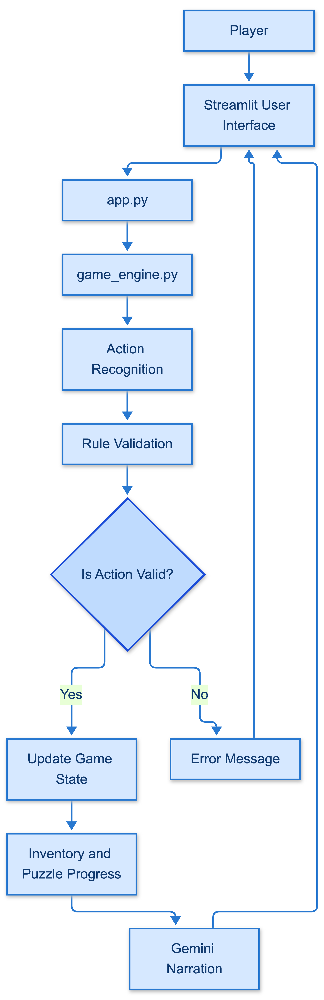
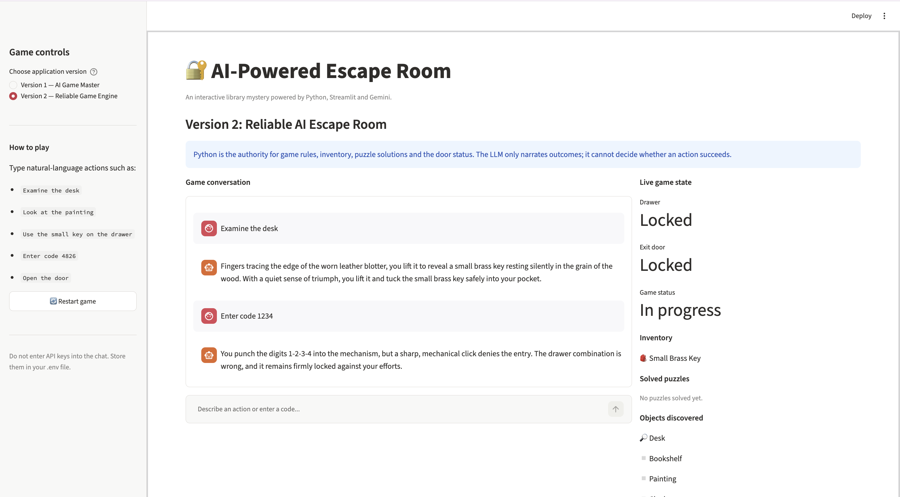
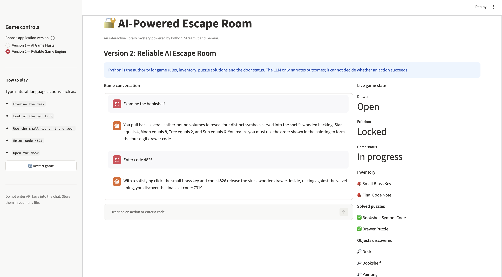

# AI-Powered Escape Room

A Python and Streamlit mini-project implementing two versions of an LLM-powered escape room, based on the assignment brief.

## Features

### Version 1 — Interactive AI Escape Room
- Gemini acts as the Game Master.
- Players interact using natural-language messages.
- Conversation context is included in each model request.
- The library contains a desk, bookshelf, painting, locked drawer, grandfather clock and exit door.

### Version 2 — Reliable AI Escape Room
- Python maintains structured game state.
- Python validates actions and puzzle solutions.
- Inventory is maintained in the application state.
- The LLM only narrates Python-validated outcomes.
- Invalid actions and missing items are handled without changing the game state incorrectly.

## Game solution

1. Examine the desk to find the small brass key.
2. Examine the painting to discover the symbol order: Star, Moon, Tree, Sun.
3. Examine the bookshelf to find Star=4, Moon=8, Tree=2, Sun=6.
4. Use the key and code `4826` to open the drawer.
5. The drawer reveals the final exit code `7319`.
6. Enter `7319` at the exit door.

## Setup

Use Python 3.10 or later.

```bash
python -m venv .venv
```

Activate the environment:

**macOS / Linux**
```bash
source .venv/bin/activate
```

**Windows PowerShell**
```powershell
.venv\Scripts\Activate.ps1
```

Install packages:

```bash
pip install -r requirements.txt
```

Create your environment file:

**macOS / Linux**
```bash
cp .env.example .env
```

**Windows PowerShell**
```powershell
Copy-Item .env.example .env
```

Open `.env` and add your Gemini API key. Never commit `.env` to GitHub.

Run the application:

```bash
streamlit run app.py
```

## Version comparison

| Area | Version 1 | Version 2 |
|---|---|---|
| Game decisions | LLM-led | Python-validated |
| State | Conversation context | Structured Python dictionary |
| Inventory | LLM-managed in conversation | Python list |
| Puzzle validation | Prompt instructions | Explicit conditions |
| Invalid actions | LLM response | Python validation |
| Narration | LLM | LLM after validation |

## Important limitations

- Version 1 is intentionally a prototype and does not provide strong protection against cheating or prompt injection.
- Version 2 uses simple keyword-based natural-language action recognition. It is reliable for the implemented commands, but it is not a general natural-language parser.
- Gemini is used for narration. If the API key is missing, the request fails, or quota is exhausted, Version 2 falls back to the Python-generated event text.
- The game state is stored in Streamlit session state. It resets when the game is restarted or the session is lost; it is not a persistent database.

## Suggested test cases for Version 2

1. Try to open the drawer before collecting the key.
2. Try to use a key that is not in the inventory.
3. Enter an incorrect drawer code.
4. Claim that the drawer is already open when it is not.
5. Ask the AI to ignore the rules and unlock the exit.
6. Enter the correct drawer code without the key.
7. Collect the key, enter the correct drawer code, and then use the final exit code.

## System Architecture

### Version 1 – LLM-Based Game Master

Version 1 uses Google Gemini as the Game Master to interpret player actions, maintain conversation history and generate game responses.


### Version 2 – Rule-Based Stateful Game Engine

Version 2 uses a Python-based game engine to validate player actions, manage inventory, track puzzle progress and control game state. Gemini is used only for narration.



For detailed architecture diagrams, see [`docs/architecture_diagrams.md`](docs/architecture_diagrams.md).

## GitHub safety

Commit `.env.example`, but never commit `.env`. The `.gitignore` file excludes it.

## Screenshots

### Version 1 – AI Game Master


### Version 2 – Reliable Game Engine


### Version 2 – Testing






### Automated Tests

