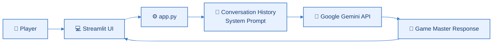
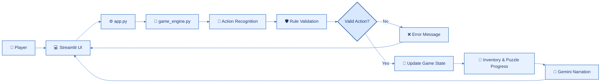
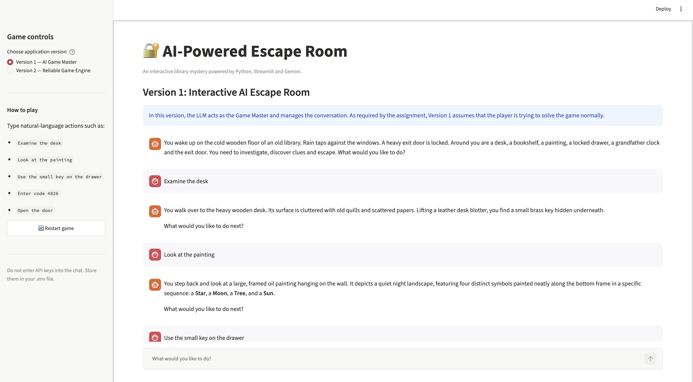
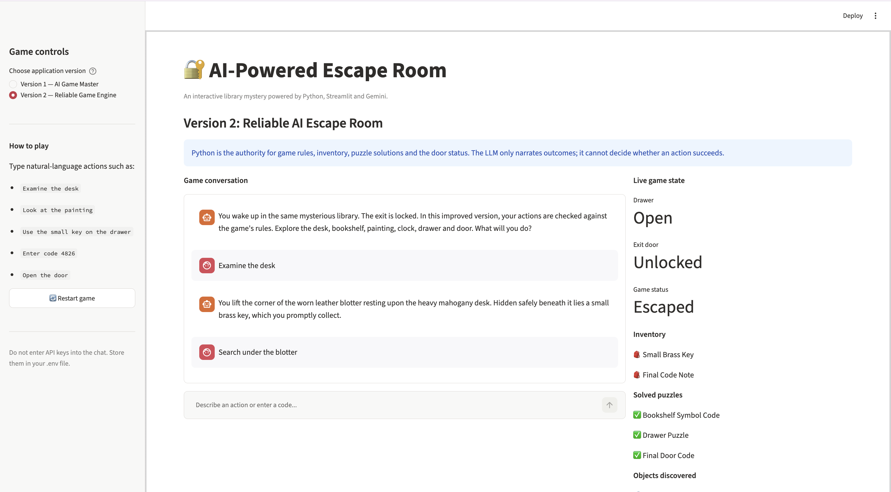
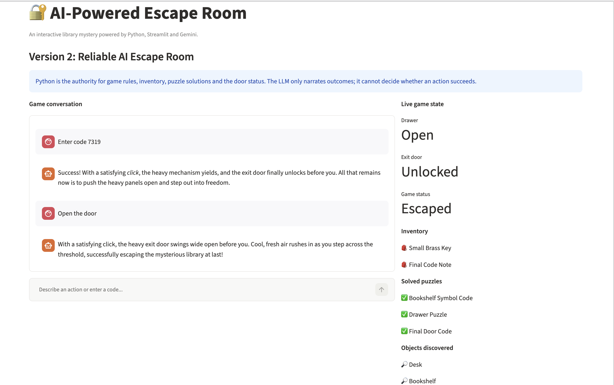
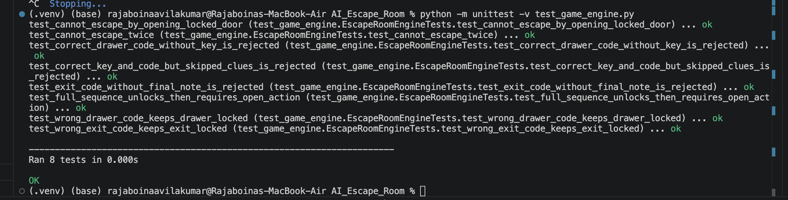

# 🔐 AI-Powered Escape Room
### An Interactive LLM-Based Game with a Reliable Python Game Engine

<p align="center">
  <strong>Python · Streamlit · Google Gemini · Game State Management</strong>
</p>

An interactive AI-powered escape room where players explore a mysterious library, investigate objects, discover hidden clues, solve puzzles and escape through natural-language interaction.

This project explores two approaches to building LLM-powered applications:

- **Version 1 – AI Game Master:** Uses Google Gemini to interpret player actions and manage the game through conversation.
- **Version 2 – Stateful Game Engine:** Uses Python to validate actions, manage inventory and control game progression, while Gemini generates contextual narration.

The main objective is to demonstrate how combining Large Language Models with deterministic application logic can create a more reliable and engaging interactive experience.

---

## 📑 Table of Contents

1. [Project Overview](#-project-overview)
2. [Project Objectives](#-project-objectives)
3. [Game Scenario](#-game-scenario)
4. [How the Game Works](#-how-the-game-works)
5. [System Architecture](#-system-architecture)
6. [Version Comparison](#-version-1-vs-version-2)
7. [Technology Stack](#-technology-stack)
8. [Testing and Validation](#-testing-and-validation)
9. [Application Screenshots](#-application-screenshots)
10. [Installation and Setup](#-installation-and-setup)
11. [Project Structure](#-project-structure)
12. [Limitations and Future Improvements](#-limitations-and-future-improvements)
13. [Project Documentation](#-project-documentation)

---

## 🎯 Project Overview

Imagine being locked inside an old mysterious library. The exit door is secured, a drawer contains an important clue, and the room is filled with objects that hold hidden information.

The player must explore the environment, interact with objects, collect items and solve puzzles to escape.

The application uses Google Gemini to provide an interactive Game Master experience. In the second version, a Python-based game engine ensures that actions follow predefined rules and that the game state remains consistent.

### ✨ Key Features

| Feature | Description |
|---|---|
| 💬 Natural-language interaction | Players interact with the game using text commands. |
| 🤖 AI Game Master | Gemini generates contextual responses and game narration. |
| 🧩 Interactive puzzles | Players investigate objects and solve a multi-step combination puzzle. |
| 🎒 Inventory management | Collected items are tracked during gameplay. |
| 🧠 Conversation context | Version 1 uses conversation history to maintain context. |
| ⚙️ Stateful game engine | Version 2 maintains structured game progress using Python. |
| 🛡️ Action validation | Incorrect actions and missing prerequisites are rejected. |
| 🔄 Restart functionality | Players can restart the escape-room experience. |

---

## 🎮 Game Scenario

### The Mysterious Library

The player begins inside a mysterious library containing six interactive objects.

| Interactive Object | Role in the Game |
|---|---|
| 🗄️ Desk | Hides a small brass key. |
| 🖼️ Painting | Reveals the correct sequence of symbols. |
| 📚 Bookshelf | Provides numerical values for the symbols. |
| 🔒 Locked Drawer | Requires the brass key and correct combination. |
| 🕰️ Grandfather Clock | An additional interactive object in the library. |
| 🚪 Exit Door | The final mechanism required to escape. |

### 🧩 Puzzle-Solving Workflow

The player must complete the following sequence:

| Step | Player Action | Expected Discovery |
|---|---|---|
| 01 | Examine the desk | Find the small brass key. |
| 02 | Examine the painting | Discover Star → Moon → Tree → Sun. |
| 03 | Examine the bookshelf | Discover the numerical values. |
| 04 | Unlock the drawer | Use the key and combination `4826`. |
| 05 | Read the hidden note | Discover the final code `7319`. |
| 06 | Unlock the exit | Enter `7319` at the exit door. |
| 07 | Open the door | Complete the escape. |

<details>
<summary><strong>🔍 Reveal the complete puzzle solution</strong></summary>

The painting reveals this symbol sequence:

**Star → Moon → Tree → Sun**

The bookshelf provides the following values:

| Symbol | Number |
|---|---:|
| ⭐ Star | 4 |
| 🌙 Moon | 8 |
| 🌳 Tree | 2 |
| ☀️ Sun | 6 |

Combining the numbers produces the drawer combination:

`4826`

The drawer contains a note with the final exit code:

`7319`

After entering the exit code, the player must explicitly open the exit door to complete the game.

</details>

---

## 🔄 How the Game Works

The project implements two different approaches to game management.

### Version 1 — Interactive AI Game Master

Version 1 uses Google Gemini as the primary Game Master.

**Execution workflow:**

1. The player enters a natural-language message.
2. Streamlit receives the player's input.
3. `app.py` maintains conversation history and constructs the prompt.
4. The prompt and player message are sent to Google Gemini.
5. Gemini interprets the action and generates a response.
6. The response is displayed in the game interface.

**Main characteristic:** The LLM manages the interaction and provides flexible, conversational gameplay.

### Version 2 — Reliable Stateful Game Engine

Version 2 introduces deterministic Python-based game logic.

**Execution workflow:**

1. The player enters an action.
2. `app.py` sends the action to `game_engine.py`.
3. The engine recognises the requested action.
4. Python validates the action against predefined rules.
5. Invalid actions are rejected without incorrectly changing the game state.
6. Valid actions update inventory, puzzle progress and object status.
7. Gemini generates narration based on the validated outcome.

**Main characteristic:** Python controls the actual game rules, while Gemini focuses on narration.

---

## 🏗️ System Architecture

### Version 1 — LLM-Based Game Master

The architecture uses a conversational workflow in which Gemini interprets player actions and generates Game Master responses.



**Architecture components**

| Component | Responsibility |
|---|---|
| Player | Provides natural-language actions. |
| Streamlit UI | Accepts input and displays responses. |
| `app.py` | Manages the application flow. |
| Conversation History | Maintains previous interactions. |
| System Prompt | Defines the Game Master instructions and scenario. |
| Gemini API | Interprets messages and generates responses. |

### Version 2 — Rule-Based Stateful Game Engine

The second architecture separates game logic from AI-generated narration.



**Architecture components**

| Component | Responsibility |
|---|---|
| `app.py` | Connects the interface and game engine. |
| `game_engine.py` | Implements the game rules and state management. |
| Action Recognition | Identifies the player's requested action. |
| Rule Validation | Checks prerequisites, inventory and puzzle conditions. |
| Game State | Tracks collected items, discovered clues and progress. |
| Gemini Narration | Generates responses based on validated game outcomes. |

### Key Architectural Improvement

Version 1 relies primarily on LLM instructions to manage gameplay. Version 2 moves critical game decisions into Python, making the outcomes more predictable and easier to test.

---

## ⚖️ Version 1 vs Version 2

| Evaluation Area | Version 1 | Version 2 |
|---|---|---|
| Main game controller | Google Gemini | Python game engine |
| Player interaction | Natural language | Natural language |
| Conversation history | Maintained | Maintained through application interaction |
| Game state | Conversation-oriented | Structured Python state |
| Inventory | LLM-managed in conversation | Explicitly tracked |
| Puzzle validation | Prompt instructions | Python conditions |
| Invalid actions | LLM-generated responses | Explicit validation |
| Narration | Gemini | Gemini after validation |
| Rule consistency | Less predictable | More controlled |

**Key takeaway:** Version 2 improves reliability by separating deterministic game rules from probabilistic language generation.

---

## 🧰 Technology Stack

| Technology | Application |
|---|---|
| 🐍 Python | Core application and game logic |
| 🌐 Streamlit | Interactive web interface |
| 🤖 Google Gemini API | Game Master and contextual narration |
| 📦 Python Dictionaries | Structured game-state management |
| 🧪 Unittest | Automated game-engine testing |
| 🐙 Git & GitHub | Source-code management and collaboration |

---

## 🧪 Testing and Validation

Version 2 is designed to validate player actions before updating the game state.

### Important Test Scenarios

| Test | Scenario | Expected Result |
|---|---|---|
| TC01 | Open drawer without collecting the key | Reject action |
| TC02 | Enter an incorrect drawer code | Reject code |
| TC03 | Enter the correct code without examining required clues | Reject action |
| TC04 | Collect key and examine both clues, then enter `4826` | Open drawer |
| TC05 | Enter an incorrect exit code | Reject code |
| TC06 | Enter `7319` without opening the door | Unlock door, remain in progress |
| TC07 | Open the unlocked exit door | Mark game as escaped |
| TC08 | Attempt to bypass rules using an instruction to the AI | Preserve Python game rules |

### Run Automated Tests

Activate the project virtual environment and run:

```bash
python -m unittest -v test_game_engine.py
```

The test suite should report all eight tests passing when the current implementation and test environment are functioning correctly.

---

## 🖥️ Application Screenshots

### Version 1 — AI Game Master

The first version demonstrates conversational gameplay using Google Gemini.



### Version 2 — Stateful Game Engine

The second version displays structured game progress and inventory.



### Action Validation

The game engine rejects incorrect actions and enforces the required puzzle sequence.

| Invalid Action | Successful Drawer Unlock |
|---|---|
|  |  |

### Successful Escape

The player enters the final code, unlocks the door and completes the game.



### Automated Test Results



---

## 🚀 Installation and Setup

### Prerequisites

| Requirement | Version |
|---|---|
| Python | 3.10 or later |
| Google Gemini API | Valid API key |
| Git | Installed |
| Internet | Required for Gemini API requests |

### Step 1 — Clone the Repository

```bash
git clone https://github.com/Avilakumar/AI-Escape-Room.git
cd AI-Escape-Room
```

### Step 2 — Create a Virtual Environment

```bash
python -m venv .venv
```

Activate the environment.

**macOS / Linux**

```bash
source .venv/bin/activate
```

**Windows PowerShell**

```powershell
.venv\Scripts\Activate.ps1
```

### Step 3 — Install Dependencies

```bash
pip install -r requirements.txt
```

### Step 4 — Configure Environment Variables

Create a local `.env` file from the provided example.

**macOS / Linux**

```bash
cp .env.example .env
```

**Windows PowerShell**

```powershell
Copy-Item .env.example .env
```

Add your Gemini API key and model configuration using the variable names specified in `.env.example`.

**Security note:** Never commit `.env` or expose your API key in screenshots, source code or GitHub.

### Step 5 — Run the Application

```bash
streamlit run app.py
```

The application will launch in your browser.

---

## 📁 Project Structure

```text
AI-Escape-Room/
│
├── app.py                         # Streamlit application
├── game_engine.py                 # Version 2 game logic
├── test_game_engine.py             # Automated tests
├── test_gemini.py                  # Gemini API test
├── requirements.txt                # Python dependencies
├── .env.example                    # Environment template
├── .gitignore                      # Ignored files
├── README.md                       # Project documentation
│
├── docs/
│   ├── architecture_diagrams.md    # Detailed architecture
│   └── project_report.md           # Project report
│
├── images/
│   ├── version1_architecture.png
│   └── version2_architecture.png
│
└── screenshots/
    ├── 01_version1_gameplay.png
    ├── 02_version2_gameplay.png
    ├── 03_wrong_code_rejected.png
    ├── 04_correct_code_accepted.png
    ├── 05_successful_escape.png
    └── 06_automated_tests.png
```

---

## ⚠️ Limitations and Future Improvements

### Current Limitations

- Version 1 depends on LLM-generated decisions and may produce inconsistent gameplay outcomes.
- Version 2 uses keyword-based natural-language action recognition rather than a general-purpose language parser.
- Gemini narration depends on API availability and quota.
- Game state is maintained in Streamlit session state and is not persisted in a database.

### Potential Future Improvements

- Introduce a more flexible natural-language action parser.
- Add additional rooms and branching puzzle scenarios.
- Implement persistent game-state storage.
- Add difficulty levels and a scoring system.
- Expand automated testing and adversarial prompt testing.

---

## 📚 Project Documentation

Additional project materials are available in the repository:

| Resource | Description |
|---|---|
| [Architecture Diagrams](docs/architecture_diagrams.md) | Detailed Version 1 and Version 2 architecture. |
| [Project Report](docs/project_report.md) | Project objectives, implementation, testing and conclusions. |
| [Application Images](images/) | Exported architecture diagrams. |
| [Testing Evidence](screenshots/) | Gameplay and automated testing screenshots. |

---

## 👨‍💻 Project Information

| Field | Details |
|---|---|
| Project Title | AI-Powered Escape Room |
| Project Type | University Mini-Project |
| Main Language | Python |
| Interface | Streamlit |
| LLM Integration | Google Gemini |
| Repository | [AI-Escape-Room](https://github.com/Avilakumar/AI-Escape-Room) |

**Developed as an exploration of LLM-powered interaction and reliable stateful application design.**