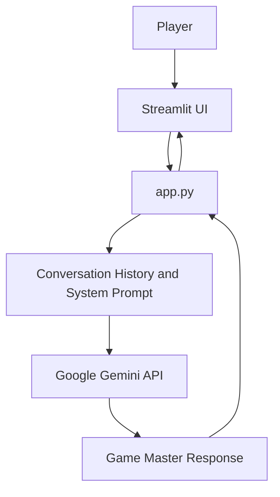
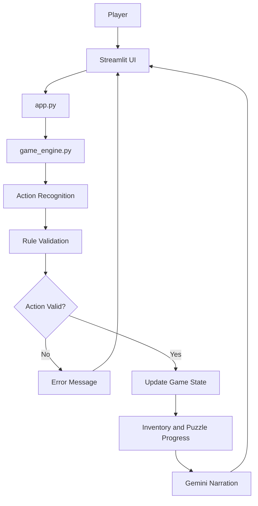

# AI-Powered Escape Room – Architecture Diagrams

## Version 1 – LLM-Based Game Master

Version 1 uses Google Gemini as the Game Master.

### Main components
- **Player:** Enters natural-language actions.
- **Streamlit UI:** Displays the game and accepts player input.
- **app.py:** Manages application flow and conversation history.
- **System prompt:** Defines the library story, puzzles and Game Master behaviour.
- **Google Gemini:** Interprets actions and generates responses.

## Version 2 – Rule-Based Stateful Game Engine

### Main components
- **Player:** Enters natural-language actions.
- **Streamlit UI:** Displays the game and current progress.
- **app.py:** Connects the interface, game engine and narration.
- **game_engine.py:** Recognises actions, validates rules and updates state.
- **Game state:** Stores inventory, discovered clues, puzzle progress and escape status.
- **Google Gemini:** Generates narration based on the validated game state.

## Key architectural difference

Version 1 relies primarily on the LLM to manage the game interaction and progression. Version 2 separates game logic from narration by using a Python-based rule engine to validate actions and maintain a consistent state.
