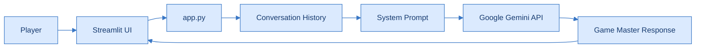
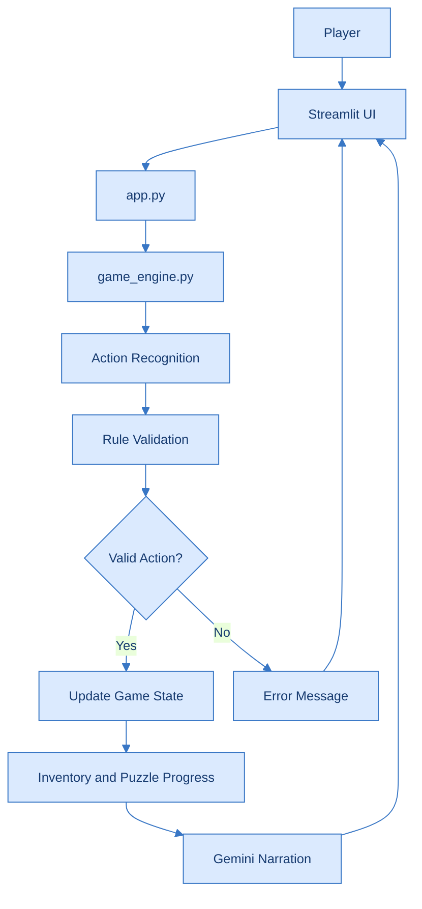

# AI-POWERED ESCAPE ROOM
## Design, Development and Testing of an LLM-Based Interactive Game

**Project Report**

# Abstract

The AI-Powered Escape Room is an interactive game developed using Python, Streamlit and the Google Gemini API. The project explores how Large Language Models (LLMs) can be integrated into interactive applications to provide natural-language interaction, contextual responses and AI-generated storytelling.

The game takes place in a mysterious library where the player must examine objects, discover clues, solve puzzles and unlock an exit door. Two versions of the application were developed. Version 1 uses an LLM as the Game Master, while Version 2 introduces a rule-based stateful game engine that validates player actions and manages game progress independently of the LLM.

The project demonstrates the advantages and limitations of LLM-driven interaction compared with deterministic rule-based control. Testing was conducted through manual gameplay and automated unit tests. The final implementation combines structured game logic with AI-generated narration to provide a more reliable and engaging experience.

**Keywords:** Artificial Intelligence, Large Language Models, Google Gemini, Python, Streamlit, Game Engine, State Management.

---

# Table of Contents

1. Introduction  
2. Problem Statement and Project Objectives  
3. Requirements Analysis  
4. Technologies and Tools  
5. Game Scenario and Puzzle Design  
6. System Architecture and Design  
7. Implementation  
8. Testing and Results  
9. Comparison of Version 1 and Version 2  
10. Limitations and Future Enhancements  
11. Conclusion  
12. References  

---

# 1. Introduction

Artificial Intelligence is increasingly being used to develop interactive applications that understand natural language and generate context-aware responses. Large Language Models provide opportunities to create applications in which users can interact with a system through conversational input rather than predefined commands.

The AI-Powered Escape Room demonstrates this concept through an interactive puzzle-solving game. The player is placed inside a mysterious library and must discover hidden objects, interpret clues and solve a sequence of puzzles to escape.

The project was developed in two stages:

- **Version 1 – LLM-Based Game Master:** Uses Google Gemini to interpret player messages and generate game responses.
- **Version 2 – Rule-Based Stateful Game Engine:** Uses Python to validate actions, enforce puzzle conditions and maintain the actual game state, while Gemini is used for narration.

This two-version approach demonstrates how AI-generated interaction can be combined with deterministic application logic.

# 2. Problem Statement and Project Objectives

## 2.1 Problem Statement

An LLM-based interactive game can provide flexible and natural conversations, but relying entirely on generated responses can make game outcomes inconsistent. For example, an LLM might accept an incorrect puzzle solution, overlook an inventory requirement or allow a player to skip an important game sequence.

The project addresses this challenge by developing two approaches: an LLM-driven Game Master and a stateful game engine that validates player actions using predefined rules.

## 2.2 Project Objectives

The main objectives are:

1. Develop an interactive escape-room application using Python and Streamlit.
2. Integrate Google Gemini for natural-language understanding and game narration.
3. Create a game environment containing at least five interactive objects.
4. Implement multiple clues and puzzles with a clear solution sequence.
5. Maintain conversation history and game progress.
6. Develop a Python-based stateful game engine.
7. Validate player actions against predefined game rules.
8. Handle invalid actions and incorrect puzzle solutions.
9. Implement restart functionality.
10. Evaluate both versions through manual and automated testing.

# 3. Requirements Analysis

The project requirements are divided into functional requirements and implementation-specific requirements.

## 3.1 Functional Requirements

| ID | Requirement | Implementation |
|---|---|---|
| FR-01 | Provide an interactive game interface | Streamlit |
| FR-02 | Support natural-language player input | Google Gemini |
| FR-03 | Include at least five interactive objects | Library environment |
| FR-04 | Provide at least three clues or puzzle elements | Painting, bookshelf and hidden key |
| FR-05 | Maintain conversation context | Conversation history |
| FR-06 | Validate player actions | Python game engine |
| FR-07 | Maintain inventory and game progress | Game-state dictionary |
| FR-08 | Reject invalid actions and incorrect sequences | Rule validation |
| FR-09 | Provide a clear winning condition | Exit-code and door-opening sequence |
| FR-10 | Allow the player to restart | Restart functionality |

## 3.2 Version-Specific Requirements

**Version 1 – LLM Game Master**

- Use an LLM as the Game Master.
- Interpret natural-language actions.
- Generate contextual responses and hints.
- Maintain conversation history.
- Provide an interactive game with a clear solution and restart option.

**Version 2 – Stateful Game Engine**

- Store game state using Python dictionaries.
- Recognise and validate player actions.
- Enforce inventory and puzzle prerequisites.
- Update game progress only after valid actions.
- Reject invalid actions with appropriate feedback.
- Keep game rules and solutions separate from AI-generated narration.
- Test normal, incorrect and adversarial action sequences.

# 4. Technologies and Tools

| Technology | Purpose |
|---|---|
| Python | Core application and game logic |
| Streamlit | Interactive web interface |
| Google Gemini API | Natural-language interaction and narration |
| Python Dictionaries | Inventory and game-state management |
| Unittest | Automated testing |
| Git and GitHub | Version control and project hosting |
| Visual Studio Code | Development environment |

# 5. Game Scenario and Puzzle Design

## 5.1 Game Environment

The game takes place in a mysterious library. The player must explore the environment and discover the information required to unlock the exit.

The interactive objects include:

1. Desk – contains a hidden brass key.
2. Bookshelf – provides numerical clues.
3. Painting – reveals the correct symbol sequence.
4. Locked drawer – requires a key and a combination.
5. Grandfather clock – forms part of the library environment.
6. Exit door – requires a final code to escape.

## 5.2 Puzzle Solution Sequence

The player must complete the following sequence:

| Step | Player Action | Expected Result |
|---|---|---|
| 1 | Search the desk | Discover the small brass key |
| 2 | Examine the painting | Discover the symbol order |
| 3 | Examine the bookshelf | Discover the symbol values |
| 4 | Calculate the combination | Obtain drawer code 4826 |
| 5 | Use the key and enter 4826 | Open the locked drawer |
| 6 | Read the note inside | Discover final code 7319 |
| 7 | Enter code 7319 | Unlock the exit door |
| 8 | Open the exit door | Complete the game |

The painting provides the symbol order: Star, Moon, Tree and Sun. The corresponding bookshelf values are 4, 8, 2 and 6, producing the drawer combination **4826**.

The note inside the drawer reveals the final exit code **7319**.

# 6. System Architecture and Design

The system was designed using two different architectures to demonstrate the difference between LLM-driven interaction and deterministic game-state management.

## 6.1 Version 1 – LLM-Based Game Master Architecture

Version 1 uses Google Gemini to interpret player messages and generate responses. The application maintains the conversation history and sends relevant context and game instructions to the model.

**Architecture explanation:**

- **Player:** Enters natural-language actions and questions.
- **Streamlit UI:** Accepts player input and displays responses.
- **app.py:** Controls the application workflow.
- **Conversation History:** Maintains previous interactions.
- **System Prompt:** Defines the Game Master role, scenario and instructions.
- **Google Gemini API:** Interprets messages and generates responses.
- **Game Master Response:** Provides clues, feedback and narrative output.

## 6.2 Version 2 – Rule-Based Stateful Game Engine Architecture

Version 2 separates game rules and state management from AI-generated narration. Python validates actions before updating the game state.

**Architecture explanation:**

- **Player and Streamlit UI:** Receive and display player interactions.
- **app.py:** Connects the user interface with the game engine.
- **game_engine.py:** Contains the game rules and state-management functions.
- **Action Recognition:** Identifies the requested player action.
- **Rule Validation:** Checks whether the action satisfies the required conditions.
- **Update Game State:** Changes the game state only when an action is valid.
- **Inventory and Puzzle Progress:** Tracks collected items and completed objectives.
- **Gemini Narration:** Generates descriptive responses based on the game situation.
- **Error Message:** Provides feedback when an action is invalid.

# 7. Implementation

## 7.1 Version 1 Implementation

Version 1 was implemented using Python and Streamlit, with Google Gemini serving as the Game Master.

The player interacts with objects using natural-language instructions. The application maintains conversation history and includes the game instructions in the context sent to Gemini.

The main implementation features include:

- Natural-language player interaction.
- AI-generated game responses and hints.
- Conversation history.
- Interactive library objects.
- Puzzle-solving and escape sequence.
- Restart functionality.

## 7.2 Version 2 Implementation

Version 2 introduces a separate Python module named `game_engine.py`.

The game state is represented using Python dictionaries. It maintains information such as:

- Player inventory.
- Examined objects.
- Solved puzzles.
- Drawer status.
- Door status.
- Escape completion.
- Game interaction history.

The engine checks the required conditions before accepting puzzle solutions.

For example, the drawer code **4826** is accepted only if the player has collected the brass key and examined both the painting and bookshelf.

Similarly, entering the exit code **7319** unlocks the door but does not automatically complete the game. The player must perform a separate door-opening action.

This approach ensures that the Python game engine controls important game outcomes rather than relying entirely on generated LLM responses.

# 8. Testing and Results

Testing was conducted to verify the application's functionality, puzzle logic and handling of invalid actions.

## 8.1 Manual Testing

| Test ID | Test Scenario | Expected Result |
|---|---|---|
| MT-01 | Search the desk | Brass key is discovered |
| MT-02 | Examine painting and bookshelf | Required clues are discovered |
| MT-03 | Enter incorrect drawer code | Code is rejected |
| MT-04 | Enter 4826 without the key | Action is rejected |
| MT-05 | Enter 4826 without examining required clues | Action is rejected |
| MT-06 | Enter 4826 with all prerequisites | Drawer opens |
| MT-07 | Enter incorrect exit code | Exit remains locked |
| MT-08 | Enter 7319 | Exit door becomes unlocked |
| MT-09 | Open the unlocked exit door | Escape is completed |

## 8.2 Automated Testing

Automated tests were implemented using Python's `unittest` framework.

The test suite verifies important game-engine behaviours, including:

- Initial game-state creation.
- Inventory and object tracking.
- Validation of drawer prerequisites.
- Rejection of incorrect puzzle codes.
- Acceptance of valid puzzle solutions.
- Exit-code validation.
- Separate door-opening behaviour.
- Successful escape completion.

**Test Result:** The implemented automated test suite completed successfully with **8 tests passing**.

## 8.3 Testing Outcome

The testing demonstrated that Version 1 supports conversational gameplay, while Version 2 provides more predictable and controlled puzzle progression through explicit validation.

The separation of game logic from AI narration helps prevent incorrect actions from changing the actual game state.

# 9. Comparison of Version 1 and Version 2

| Evaluation Criteria | Version 1 | Version 2 |
|---|---|---|
| Main control | Google Gemini | Python game engine |
| Player interaction | Natural language | Validated actions with narration |
| State management | Conversation context | Explicit state dictionary |
| Rule enforcement | LLM instructions | Python validation |
| Inventory management | Conversation-based context | Structured inventory |
| Invalid action handling | Model-generated response | Rule-based rejection |
| Narration | Gemini | Gemini |
| Predictability | Less predictable | More controlled |

Version 1 focuses on flexibility and conversational interaction. Version 2 focuses on reliable execution, explicit state tracking and consistent enforcement of puzzle rules.

# 10. Limitations and Future Enhancements

## 10.1 Current Limitations

- The game currently contains a single library environment.
- The number of puzzles and interactive objects is limited to the implemented scenario.
- Version 1 depends on the consistency of LLM-generated responses.
- Version 2 requires predefined rules for supported game actions.
- Gemini API availability and usage limits can affect AI-generated narration.

## 10.2 Future Enhancements

Possible improvements include:

1. Adding multiple rooms and additional puzzle scenarios.
2. Introducing difficulty levels and adjustable hints.
3. Adding visual animations and sound effects.
4. Improving the user interface and game experience.
5. Adding persistent player progress across sessions.
6. Expanding automated testing with additional edge cases.
7. Supporting more complex interactions between objects.
8. Improving AI narration using structured game-state context.

# 11. Conclusion

The AI-Powered Escape Room demonstrates how Large Language Models can be integrated into an interactive application and combined with traditional software engineering techniques.

The first version uses Google Gemini as an LLM-based Game Master, providing flexible natural-language interaction and AI-generated storytelling. The second version introduces a Python-based stateful game engine that validates player actions, manages inventory and enforces puzzle prerequisites.

The implementation and testing demonstrate that separating deterministic game logic from AI-generated narration improves control over game progression while retaining the benefits of conversational AI.

Overall, the project provides a practical example of combining Artificial Intelligence, Python programming, state management and interactive application development to create an engaging and reliable game experience.

# 12. References

1. Google. (n.d.). *Gemini API Documentation*. https://ai.google.dev/gemini-api/docs
2. Streamlit. (n.d.). *Streamlit Documentation*. https://docs.streamlit.io/
3. Python Software Foundation. (n.d.). *Python Documentation*. https://docs.python.org/3/
4. Python Software Foundation. (n.d.). *unittest — Unit Testing Framework*. https://docs.python.org/3/library/unittest.html
5. Mermaid. (n.d.). *Mermaid Documentation*. https://mermaid.js.org/

---

**End of Project Report**