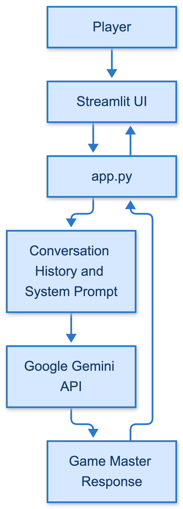

# 🔐 AI-Powered Escape Room – Version 1

### 🤖 LLM-Based Interactive Game Master

<p align="center">
  
</p>

<p align="center">
  <b>An interactive escape room powered by Google Gemini and Python.</b>
</p>

---

## 📌 1. Project Overview

Version 1 is an AI-powered interactive escape room in which a Large Language Model (LLM) acts as the Game Master.

The player is trapped inside a mysterious library and must explore objects, discover hidden clues, solve puzzles and escape by communicating with the AI using natural language.

Google Gemini interprets player instructions, maintains conversation context and generates dynamic responses throughout the game.

## ✨ 2. Key Features

| Feature | Description |
|---|---|
| 🤖 AI Game Master | Google Gemini manages the interactive gameplay. |
| 💬 Natural Language Interaction | Players communicate using everyday language. |
| 🔍 Object Exploration | Investigate different objects in the library. |
| 🧩 Puzzle Solving | Discover clues and solve multiple puzzles. |
| 🧠 Conversation Memory | Maintains previous interactions during gameplay. |
| 🎭 Dynamic Responses | Generates contextual responses to player actions. |
| 🔄 Restart Game | Allows players to restart the escape room. |

## 🏛️ 3. Game Environment

The game takes place in a mysterious library containing six interactive objects.

| Object | Purpose |
|---|---|
| 🪑 Desk | Find a small brass key under the blotter. |
| 🖼️ Painting | Discover the correct sequence of symbols. |
| 📚 Bookshelf | Find the numerical values associated with the symbols. |
| 🔐 Locked Drawer | Use the key and puzzle solution to unlock it. |
| 🕰️ Grandfather Clock | Explore the library environment. |
| 🚪 Exit Door | Enter the final code to unlock the exit. |

## 🧩 4. Puzzle Solution

The player must discover the following clues:

| Symbol | Numerical Value |
|---|---:|
| ⭐ Star | 4 |
| 🌙 Moon | 8 |
| 🌳 Tree | 2 |
| ☀️ Sun | 6 |

**Painting sequence:** Star → Moon → Tree → Sun

<details>
<summary><b>🔑 Complete solution</b></summary>

- Drawer code: `4826`
- Final exit code: `7319`

The player must find the brass key, solve the painting and bookshelf clues, unlock the drawer, and explicitly read the note to discover the final exit code.

</details>

## 🏗️ 5. System Architecture

The architecture diagram above illustrates the workflow of Version 1.

The system follows an LLM-driven architecture:

1. **Player Input:** The player submits an action through the Streamlit interface.
2. **Application Layer:** Python receives the input and combines it with the system instructions and conversation history.
3. **LLM Processing:** Google Gemini interprets the player's action and generates a contextual response.
4. **Response Generation:** The AI Game Master responds with clues, hints or feedback.
5. **Conversation Memory:** The interaction is stored in session history to maintain context during the game.

**Main concept:** The LLM handles most of the interpretation and progression of the gameplay, making the experience flexible and conversational.

## 🛠️ 6. Technology Stack

| Technology | Purpose |
|---|---|
| 🐍 Python | Application logic |
| 🌐 Streamlit | Interactive web interface |
| ✨ Google Gemini API | AI Game Master and response generation |
| 🧠 Session State | Conversation history and memory |

## 📂 7. Project Structure

```text
version1/
├── app_v1.py
└── README.md
```

The application imports the shared `game_engine.py` module from the project root for Gemini integration and game instructions.

## ⚙️ 8. Installation and Execution

### Step 1: Clone the repository

```bash
git clone https://github.com/Avilakumar/AI-Escape-Room.git
cd AI-Escape-Room
```

### Step 2: Create and activate a virtual environment

**macOS / Linux**

```bash
python -m venv .venv
source .venv/bin/activate
```

**Windows**

```bash
python -m venv .venv
.venv\Scripts\activate
```

### Step 3: Install dependencies

```bash
pip install -r requirements.txt
```

### Step 4: Configure the Gemini API key

Create a `.env` file in the project root and configure the API key using the environment variable expected by `game_engine.py`.

⚠️ Never upload your actual API key to GitHub.

### Step 5: Run Version 1

From the project root directory:

```bash
streamlit run version1/app_v1.py
```

## 🎮 9. How to Play

1. Launch the application.
2. Read the escape room introduction.
3. Explore the library using natural-language commands.
4. Investigate objects and discover hidden clues.
5. Solve the painting and bookshelf puzzles.
6. Find the brass key and unlock the drawer.
7. Read the note to discover the final exit code.
8. Unlock and open the exit door.

## ⚠️ 10. Limitations

- Game progression depends heavily on LLM interpretation.
- AI responses may occasionally be inconsistent.
- The model may misunderstand certain player actions.
- Strict validation of every action is not guaranteed.

## 🚀 11. Future Enhancements

- Add more rooms and interactive environments.
- Introduce multiple difficulty levels.
- Improve consistency of AI-generated responses.
- Add more complex puzzles and challenges.
- Improve natural-language action interpretation.

## 🔗 12. Related Implementation

Explore the second implementation:

➡️ [Version 2 – Stateful Rule-Based Game Engine](../version2/README.md)

---

<p align="center">
  <b>AI-Powered Escape Room | Version 1.0</b><br/>
  Built with Python, Streamlit and Google Gemini
</p>