# 🔐 AI-Powered Escape Room – Version 2

### ⚙️ Stateful Rule-Based Game Engine with AI Narration

<p align="center">
  <b>A deterministic escape room powered by Python game logic and Google Gemini narration.</b>
</p>

---

## 📌 1. Project Overview

Version 2 introduces a stateful Python-based game engine to improve the reliability and consistency of the AI-powered escape room.

Unlike Version 1, where the LLM handles most game interpretation and progression, Version 2 separates game logic from AI-generated narration.

Python controls the game rules, validates player actions, manages inventory, tracks puzzle progress and determines whether the player can escape.

Google Gemini is used to generate contextual narration based on the actions validated by the game engine.

## ✨ 2. Key Features

| Feature | Description |
|---|---|
| ⚙️ Stateful Game Engine | Maintains the current game state using Python dictionaries. |
| ✅ Action Validation | Checks player actions against predefined game rules. |
| 🎒 Inventory Management | Tracks collected items such as the brass key. |
| 🧩 Puzzle Validation | Validates painting and bookshelf clues. |
| 🔐 Code Verification | Checks drawer and exit codes. |
| 📊 Progress Tracking | Tracks discovered objects and solved puzzles. |
| 🚫 Invalid Action Handling | Rejects actions that do not satisfy game conditions. |
| 🤖 AI Narration | Google Gemini generates contextual responses for validated events. |
| 🔄 Restart Functionality | Resets the game to its initial state. |

## 🏛️ 3. Game Environment

The player must escape from a mysterious library containing six interactive objects.

| Object | Purpose |
|---|---|
| 🪑 Desk | Find a small brass key under the blotter. |
| 🖼️ Painting | Discover the correct sequence of symbols. |
| 📚 Bookshelf | Examine the numerical values associated with the symbols. |
| 🔐 Locked Drawer | Unlock it using the brass key and correct code. |
| 🕰️ Grandfather Clock | Explore the library environment. |
| 🚪 Exit Door | Unlock and open the exit to escape. |

## 🧩 4. Puzzle Solution

The player must discover the following clues:

| Symbol | Numerical Value |
|---|---:|
| ⭐ Star | 4 |
| 🌙 Moon | 8 |
| 🌳 Tree | 2 |
| ☀️ Sun | 6 |

**Painting sequence:** Star → Moon → Tree → Sun

<details>
<summary><b>🔑 Complete solution</b></summary>

- Drawer code: `4826`
- Final exit code: `7319`

The player must find the brass key, examine the painting and bookshelf, unlock the drawer, and explicitly read the note to discover the final exit code.

</details>


## 🏗️ 5. System Architecture

The following diagram illustrates the hybrid Python and LLM architecture of Version 2. Python controls action validation and game progression, while Google Gemini generates narration for validated events.

```mermaid
flowchart LR
    A["👤 Player"] --> B["🌐 Streamlit UI"]
    B --> C["🐍 app_v2.py"]
    C --> D["⚙️ game_engine.py"]
    D --> E["🔍 Action Recognition"]
    E --> F["✅ Rule Validation"]
    F --> G{"Valid Action?"}

    G -- No --> H["❌ Error Response"]
    H --> B

    G -- Yes --> I["📊 Update Game State"]
    I --> J["🎒 Inventory & Puzzle Progress"]
    J --> K["📝 Build Narration Prompt"]
    K --> L["🤖 Google Gemini API"]
    L --> M["🎮 Game Master Narration"]
    M --> B

    style A fill:#dbeafe,stroke:#2563eb,color:#1e3a8a
    style B fill:#dbeafe,stroke:#2563eb,color:#1e3a8a
    style C fill:#dbeafe,stroke:#2563eb,color:#1e3a8a
    style D fill:#dbeafe,stroke:#2563eb,color:#1e3a8a
    style E fill:#dbeafe,stroke:#2563eb,color:#1e3a8a
    style F fill:#dbeafe,stroke:#2563eb,color:#1e3a8a
    style G fill:#fef3c7,stroke:#d97706,color:#78350f
    style H fill:#fee2e2,stroke:#dc2626,color:#7f1d1d
    style I fill:#dcfce7,stroke:#16a34a,color:#14532d
    style J fill:#dcfce7,stroke:#16a34a,color:#14532d
    style K fill:#dbeafe,stroke:#2563eb,color:#1e3a8a
    style L fill:#dcfce7,stroke:#16a34a,color:#14532d
    style M fill:#fef3c7,stroke:#d97706,color:#78350f
```



### Architecture Explanation

1. **Player:** Submits an action through the interface.
2. **Streamlit UI:** Receives the player's input.
3. **app_v2.py:** Passes the action to the game engine.
4. **game_engine.py:** Processes and validates the action.
5. **Action Recognition:** Identifies the requested game operation.
6. **Rule Validation:** Checks whether the action satisfies predefined conditions.
7. **Valid Action Decision:** Rejects invalid actions or allows valid actions to continue.
8. **Game State Update:** Updates inventory, discovered objects and puzzle progress.
9. **Build Narration Prompt:** Prepares the validated event and game state for Gemini.
10. **Google Gemini API:** Generates contextual narration.
11. **Game Master Narration:** Returns the response to the player through Streamlit.

## ⚙️ 6. Game State Management

The Python game engine maintains structured information about the player's progress.

| Game State | Purpose |
|---|---|
| 🎒 Inventory | Stores collected items. |
| 🔍 Discovered Objects | Tracks examined library objects. |
| 🧩 Solved Puzzles | Tracks completed puzzles. |
| 🔐 Drawer Status | Determines whether the drawer is locked or open. |
| 📝 Note Status | Tracks whether the final note has been read. |
| 🚪 Exit Status | Tracks whether the exit is unlocked. |
| 🏆 Escape Status | Determines whether the player has successfully escaped. |

## 🛠️ 7. Technology Stack

| Technology | Purpose |
|---|---|
| 🐍 Python | Game engine and validation logic |
| 🌐 Streamlit | Interactive web interface |
| ✨ Google Gemini API | Contextual AI narration |
| 📦 Python Dictionaries | Structured game state management |
| 🧪 Unittest | Automated testing |

## 📂 8. Project Structure

```text
version2/
├── app_v2.py
├── game_engine.py
└── README.md
```

The standalone Version 2 implementation contains its own game engine. Shared dependencies are maintained in the root `requirements.txt`.

## ⚙️ 9. Installation and Execution

### Step 1: Clone the repository

```bash
git clone https://github.com/Avilakumar/AI-Escape-Room.git
cd AI-Escape-Room
```

### Step 2: Create and activate a virtual environment

**macOS / Linux**

```bash
python -m venv .venv
source .venv/bin/activate
```

**Windows**

```bash
python -m venv .venv
.venv\Scripts\activate
```

### Step 3: Install dependencies

```bash
pip install -r requirements.txt
```

### Step 4: Configure the Gemini API key

Create a `.env` file in the project root and configure the API key using the environment variable expected by the Version 2 game engine.

⚠️ Never upload your actual API key to GitHub.

### Step 5: Run Version 2

From the project root directory:

```bash
streamlit run version2/app_v2.py
```

## 🎮 10. How to Play

Follow these steps to complete the escape room:

| Step | Player Action | Expected Result |
|---:|---|---|
| 1 | Examine the desk | Discover the brass key. |
| 2 | Examine the painting | Discover the symbol sequence. |
| 3 | Examine the bookshelf | Discover symbol values. |
| 4 | Inspect the drawer | Check its locking conditions. |
| 5 | Enter `4826` | Unlock the drawer if prerequisites are satisfied. |
| 6 | Read the note | Reveal the final exit code `7319`. |
| 7 | Enter `7319` | Unlock the exit door. |
| 8 | Open the door | Successfully escape. |

## 🧪 11. Automated Testing

Version 2 includes automated unit tests to verify the game engine's behavior and enforce the game rules.

Run the tests from the project root:

```bash
python -m unittest -v test_game_engine.py
```

The test cases cover:

- Initial game state.
- Collecting the brass key.
- Examining the painting and bookshelf.
- Rejecting incorrect drawer codes.
- Preventing access to the drawer without required conditions.
- Requiring the note to be read before revealing the final exit code.
- Unlocking the exit door.
- Completing the escape sequence.
- Preventing repeated escape completion.

## 🔄 12. Version 1 vs Version 2

| Aspect | Version 1 | Version 2 |
|---|---|---|
| Architecture | LLM-driven | Hybrid Python + LLM |
| Game progression | LLM-led | Python-controlled |
| Action validation | LLM interpretation | Predefined Python rules |
| Game state | Conversation history | Structured state |
| Inventory | Conversation-based | Explicit state management |
| Puzzle verification | LLM interpretation | Rule-based validation |
| AI responsibility | Game Master | Narration |
| Predictability | Less deterministic | More deterministic |

## ⚠️ 13. Limitations

- The game engine relies on predefined actions and conditions.
- New puzzles require changes to the Python game logic.
- Natural-language input may need normalization to match supported actions.
- AI-generated narration requires access to the Gemini API.

## 🚀 14. Future Enhancements

- Introduce multiple rooms and more complex puzzles.
- Add configurable difficulty levels.
- Improve natural-language action normalization.
- Implement persistent game progress.
- Expand automated testing.
- Add additional interactive environments.

## 🔗 15. Related Implementation

Explore the first implementation:

➡️ [Version 1 – LLM-Based Interactive Game Master](../version1/README.md)

---

<p align="center">
  <b>AI-Powered Escape Room | Version 2.0</b><br/>
  Built with Python, Streamlit and Google Gemini
</p>